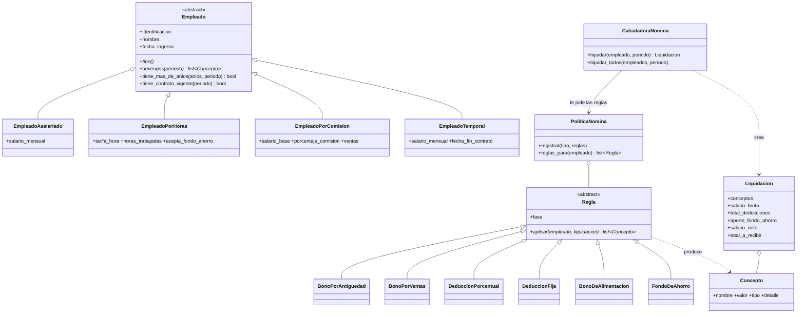

# Sistema de nómina POO

Sistema de nómina en Python para una empresa con cuatro tipos de empleado: asalariado, por horas, por comisión y temporal. Cada tipo calcula su salario a su manera, y los bonos, deducciones y beneficios se aplican como reglas separadas.

Actividad de la Unidad 3 de Ingeniería de Software, Universidad de Cartagena (programa a distancia).
CIPA SoloLeveling, integrante único: Andrés David Cantillo Castro. Hice todos los roles (análisis, diseño, código, pruebas y documentación).

## Cómo correrlo

Necesitas Python 3.10 o superior.

```bash
pip install -r requirements-dev.txt   # solo instala pytest
python main.py                         # liquida octubre de 2026 para un empleado de cada tipo
python -m pytest -v                    # corre las 65 pruebas
```

`main.py` imprime el desprendible de cada empleado, el resumen de la nómina y dos intentos de datos inválidos (horas y ventas negativas) que el sistema rechaza.

## Reglas del enunciado y dónde quedaron

| Regla | Cómo quedó | Archivo |
|---|---|---|
| Asalariado: salario fijo | `devengos()` devuelve el salario básico | `nomina/empleados/asalariado.py` |
| Asalariado: bono del 10 % con más de 5 años | `BonoPorAntiguedad("0.10", 5)` | `nomina/reglas/bonos.py` |
| Por horas: tarifa por hora, extra sobre 40 h a 1,5x | `horas_ordinarias`, `horas_extra` y `devengos()` | `nomina/empleados/por_horas.py` |
| Por horas: no recibe bonos | La política no le registra ningún bono | `nomina/configuracion.py` |
| Comisión: base + % sobre ventas | `devengos()` devuelve salario básico y comisión | `nomina/empleados/por_comision.py` |
| Comisión: bono del 3 % si las ventas superan $20.000.000 | `BonoPorVentas(20_000_000, "0.03")` | `nomina/reglas/bonos.py` |
| Temporal: salario fijo, contrato definido, sin bonos ni beneficios | `fecha_fin_contrato` y `tiene_contrato_vigente()`; la política no le registra reglas | `nomina/empleados/temporal.py` |
| Seguridad social y pensión: 4 % del bruto | `DeduccionPorcentual("Seguridad social y pensión", 0.04)` | `nomina/configuracion.py` |
| ARL | `DeduccionPorcentual("ARL", 0.00522)` | `nomina/configuracion.py` |
| Bono de alimentación $1.000.000 para permanentes | `BonoDeAlimentacion(1_000_000)` para asalariado y comisión | `nomina/reglas/beneficios.py` |
| Fondo de ahorro 2 % para por horas con más de 1 año, si acepta | `FondoDeAhorro("0.02", 1)` | `nomina/reglas/beneficios.py` |
| Neto nunca negativo | La calculadora lanza `SalarioNetoNegativoError` | `nomina/calculadora.py` |
| Horas no negativas | Setter de `horas_trabajadas` lanza `ValorNegativoError` | `nomina/empleados/por_horas.py` |
| Ventas no menores a $0 | Setter de `ventas` lanza `ValorNegativoError` | `nomina/empleados/por_comision.py` |

## Estructura

```
nomina/
  empleados/        Empleado (abstracta) y los 4 tipos. Solo saben cuánto devengan.
  reglas/           Un archivo por familia de reglas: bonos, deducciones, beneficios.
  calculadora.py    Aplica las reglas en orden y valida el neto. No conoce los tipos.
  politica.py       Dice qué reglas le tocan a cada tipo de empleado.
  configuracion.py  Arma la política con las reglas del enunciado. Único lugar con los porcentajes.
  liquidacion.py    El desprendible: guarda conceptos y calcula bruto, neto y total.
  conceptos.py      Cada línea del desprendible y su tipo (devengo, deducción, aporte, beneficio).
  reporte.py        Convierte una liquidación en texto. Separado del cálculo.
  dinero.py, fechas.py, periodo.py, validaciones.py, errores.py   Piezas pequeñas de apoyo.
tests/              65 pruebas con pytest.
main.py             Demo.
```

## Diagrama de clases



## Cómo se calcula una liquidación

1. Se revisa que el contrato esté vigente en el mes.
2. El empleado entrega sus devengos (salario, horas, comisión).
3. Se aplican sus reglas por fase: primero bonos, después deducciones (sobre el bruto ya con bonos), al final fondo de ahorro y beneficios.
4. Se valida que el salario neto no quede negativo.

```
salario bruto   = devengos + bonos
salario neto    = bruto - deducciones - aporte al fondo de ahorro
total a recibir = neto + beneficios no salariales (bono de alimentación)
```

## SOLID en este proyecto

- **S, responsabilidad única.** Cada clase hace una cosa: el empleado dice cuánto devenga, cada regla calcula un solo concepto, `Liquidacion` suma y resta, `CalculadoraNomina` coordina y `reporte.py` solo presenta. Si cambia el formato del desprendible, no se toca el cálculo.
- **O, abierto/cerrado.** Para agregar una deducción, un bono o un tipo de empleado nuevo se crea una clase y se registra en `configuracion.py`. La calculadora no se toca. Hay pruebas que lo demuestran con un `Practicante` y una `DeduccionFija` (`tests/test_extension.py`).
- **L, sustitución de Liskov.** Cualquier subclase de `Empleado` funciona en la calculadora. El temporal no lanza errores raros: responde `tiene_contrato_vigente()` igual que los demás, solo que con su fecha de fin. Una prueba crea `AsalariadoDirectivo` y hereda las reglas del asalariado.
- **I, segregación de interfaces.** Las reglas que necesitan algo específico piden solo eso con un `Protocol`: `BonoPorVentas` pide `TieneVentas` y `FondoDeAhorro` pide `PuedeAhorrar`. La calculadora solo pide `FuenteDeReglas` (un método).
- **D, inversión de dependencias.** `CalculadoraNomina` depende de las abstracciones `Regla` y `FuenteDeReglas`, no de clases concretas. La política se inyecta por el constructor. Los tipos concretos solo aparecen en `configuracion.py`. Una prueba revisa que `calculadora.py` no nombre ningún tipo concreto ni use `isinstance`.

## Código limpio y buenas prácticas

- Plata con `Decimal`, no con `float`, y redondeo al peso en cada concepto.
- Errores con nombre propio (`ValorNegativoError`, `SalarioNetoNegativoError`, `ContratoNoVigenteError`...) para saber qué regla se rompió.
- Validación en el constructor y en los setters: si alguien actualiza `horas_trabajadas = -5`, se rechaza y el valor anterior queda intacto.
- Sin números mágicos regados: porcentajes, umbrales y la tarifa de ARL están en `configuracion.py` o como parámetros con nombre.
- Totales calculados como propiedades: nunca quedan desactualizados.
- Nombres en español del dominio (devengos, deducciones, liquidación) y funciones cortas.

## Refactorización

La versión 1 (commit `feat: calculadora de nómina v1...`) funcionaba y pasaba todas las pruebas, pero las reglas estaban dentro de la calculadora con `isinstance`. Cada regla nueva obligaba a abrir la calculadora y meter otro `if`.

En el commit `refactor: reglas inyectables...` saqué cada regla a su propia clase, creé la política y dejé la calculadora sin tipos concretos. Las 54 pruebas que ya existían siguieron pasando sin cambiar ningún valor esperado. Eso es lo que hace segura una refactorización: el comportamiento no cambió, solo el diseño.

## Pruebas

65 pruebas con pytest, en cinco archivos:

- `test_base.py`: dinero, validaciones, fechas, periodo y conceptos.
- `test_empleados.py`: devengos de cada tipo y datos inválidos.
- `test_reglas_negocio.py`: cada regla del enunciado con los valores hechos a mano en comentarios.
- `test_extension.py`: diseño (tipo nuevo, subclase, ARL configurable, orden por fase, neto negativo).
- `test_reporte.py`: desprendible, resumen y que el demo corra.

Casos borde probados: exactamente 5 años (no hay bono) y un día más (sí hay), exactamente 40 horas (no hay extra), exactamente $20.000.000 (no hay bono) y un peso más (sí hay), exactamente 1 año para el fondo (no aplica), 0 horas (neto en cero, no negativo) y neto exactamente cero (se permite).

## Metodología

Trabajé con desarrollo incremental en iteraciones cortas y TDD ligero, tomando prácticas de XP:

1. Cada iteración tenía un objetivo pequeño (piezas base, empleados, reglas, refactor, reporte, documentación).
2. Escribía las pruebas de lo que tenía que pasar con los valores calculados a mano, y después el código hasta que pasaran.
3. Cuando algo funcionaba pero quedaba mal diseñado, lo refactorizaba con las pruebas como red de seguridad.
4. Cada iteración terminaba con todas las pruebas en verde y un commit con mensaje claro.

El historial de Git es la evidencia del proceso:

```bash
git log --oneline
```

Escogí esto en vez de algo más pesado como Scrum completo porque el CIPA es de un solo integrante y el alcance es corto. Scrum tiene sentido con equipo, roles y sprints de varias semanas; aquí lo que más aportaba era iterar rápido con pruebas.

## Supuestos

El enunciado deja algunas cosas abiertas. Esto fue lo que asumí, y todo se puede cambiar en `configuracion.py` o por parámetro:

1. **ARL de 0,522 %**, la tarifa del riesgo I (trabajo de oficina), sobre el salario bruto. El enunciado la pone como deducción y así quedó, aunque en Colombia la ARL normalmente la paga el empleador.
2. **El 4 % va sobre todo el bruto**, incluyendo bonos y comisiones, porque el enunciado dice "salario bruto".
3. **El bono de alimentación es un pago no salarial.** Se suma a lo que recibe el empleado pero no entra en la base de las deducciones.
4. **El 2 % del fondo de ahorro sale del salario del empleado** y se deposita en su fondo. Se muestra aparte de las deducciones obligatorias. Si la empresa lo pusiera de su bolsillo, se cambia el tipo del concepto a `BENEFICIO` en una línea.
5. **Las 40 horas son del periodo que se liquida**, porque el enunciado no dice si son semanales. El límite es un parámetro.
6. **"Más de" es estrictamente mayor**: 5 años exactos, 1 año exacto o $20.000.000 exactos no alcanzan.
7. **La antigüedad se mide al último día del mes liquidado.**
8. **El bono del 10 % sale del salario fijo**, no de otros bonos.
9. **La nómina es mensual** y al temporal se le paga el mes completo si su contrato se cruza con ese mes (no se prorratean días).

## Decisiones de diseño

| Decisión | Alternativas que consideré | Por qué esta | Lo que cuesta |
|---|---|---|---|
| Cada bono, deducción y beneficio es una clase `Regla` | Métodos en cada subclase de empleado; `if` por tipo en la calculadora (la v1) | Agregar o cambiar una regla no toca la calculadora ni los empleados, y cada regla se prueba sola | Más archivos y clases que leer |
| Una `PoliticaNomina` decide qué reglas le tocan a cada tipo | Que cada empleado declare sus reglas | El empleado no carga lógica de bonos y toda la configuración queda en un solo archivo | La política sí conoce los tipos concretos, pero está concentrada en `configuracion.py` |
| Las reglas se ordenan por `Fase` | Confiar en el orden en que se registran | Las deducciones siempre se calculan sobre el bruto con bonos, aunque alguien las registre primero | Un concepto más que entender |
| `Decimal` para la plata | `float` | Evita errores de centavos (0,1 + 0,2 en float no da 0,3) | Un poco más verboso |
| El neto negativo lanza un error | Recortarlo a 0 o devolver un mensaje | Recortar escondería un problema de datos; un error obliga a revisarlo | Quien use la calculadora debe manejar la excepción |
| `Protocol` para lo que pide cada regla | `isinstance` dentro de la regla | La regla funciona con cualquier empleado que tenga ese dato, sin conocer su clase | Hay que leer el `Protocol` para saber qué necesita |
| Horas y ventas como atributos del empleado con setter validado | Un objeto aparte de "novedades del mes" | Más simple para el alcance de la actividad | En un sistema real separaría las novedades por periodo |

## Autor

Andrés David Cantillo Castro · acantillom@unicartagena.edu.co · CIPA SoloLeveling
